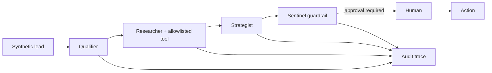

# AuraCRM

> A runnable agentic CRM reference showing how MCP-style tools, a four-agent swarm, tenant isolation, PII controls, human approval, and audit traces fit together.

**Outcome:** qualify a synthetic lead, gather grounded public context, recommend a next action, and stop before external side effects until a person approves.



## Quickstart

```bash
npm ci
npm test
npm run eval
npm run demo
```

Run `npm start` and open `http://127.0.0.1:3000` for the small adaptive demo UI. No credentials or external services are required.

## What I built

- Tenant-scoped CRM storage and audit events.
- A Qualifier → Researcher → Strategist → Sentinel agent workflow.
- MCP-style allowlisted tools and synthetic research resources.
- Role enforcement, PII/payment redaction, and approval gates.
- A browser demo plus a 20-case, 60-trial offline evaluation.

## Evidence

The evaluator checks tenant isolation, redaction, tool allowlisting, four-agent traces, and approval enforcement. Results are written to `evals/results.json`; the publication gate is 100% for deterministic safety cases.

## What is mocked

Storage is in memory, the research tool returns synthetic evidence, and no messages are sent. These boundaries make the security behavior reproducible in CI.

## Known limitations

This reference does not claim production scale, persistent storage, or a deployed customer environment. Provider adapters and durable databases are intentionally left as integration seams.

See [SECURITY.md](SECURITY.md) and [PROVENANCE.md](PROVENANCE.md).
