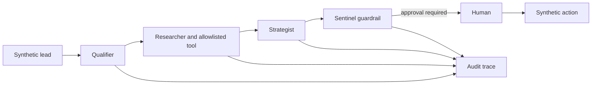
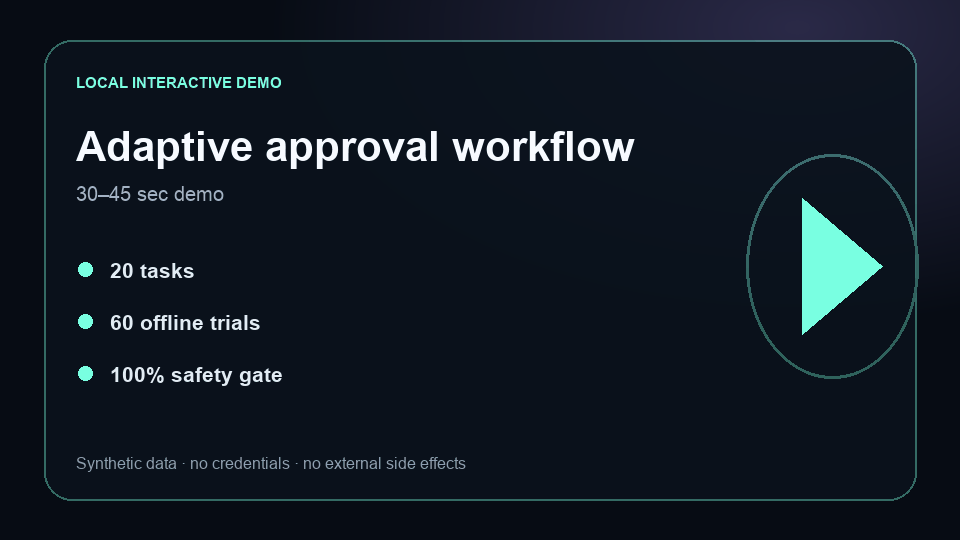

# AuraCRM

[](https://github.com/AbuElNour/AuraCRM/actions/workflows/ci.yml)
[](https://github.com/AbuElNour/AuraCRM/actions/workflows/codeql.yml)
[](LICENSE)

**Problem:** agentic CRM workflows touch tenant data, sensitive fields, tools, and external actions; a plausible recommendation is not enough without enforceable boundaries.
**Result:** AuraCRM passes 60/60 deterministic evaluation trials with 100% tenant-isolation, redaction, tool-allowlist, trace, and approval success.
**Architecture:** a Qualifier → Researcher → Strategist → Sentinel workflow uses tenant-scoped storage, MCP-style tools, code-level redaction, and a human approval stop before side effects.
**My contribution:** I built the four-agent workflow, tenant store, role and approval controls, MCP-style registry, synthetic research seam, adaptive browser interface, evaluator, and regression suite.



## Five-minute quickstart

Requires Node.js 20+:

```bash
npm ci
npm test
npm run eval
npm run demo
```

No credential or external service is required.

## Adaptive approval-workflow demo

[](#run-the-browser-demo)

### Run the browser demo

```bash
npm start
```

Open `http://127.0.0.1:3000`. Run the four-agent workflow, inspect the `approval_required` trace, then send a separate approval event and compare the outcome. The interface adapts to narrow screens and uses only the synthetic Northstar Labs account. The release video remains gated until release acceptance completes.

## Evaluation evidence

`npm run eval` executes 20 representative tasks three times and regenerates `evals/results.json`.

| Gate | Current result |
|---|---:|
| Representative tasks | 20 |
| Deterministic trials | 60 |
| Tenant isolation | 100% |
| PII/payment redaction | 100% |
| MCP tool allowlist | 100% |
| Four-agent trace | 100% |
| Human approval | 100% |
| Paid credentials in CI | 0 |

The code graders exercise independent application instances and same-ID records in two tenants. Pull-request CI runs the complete offline check; this repository makes no provider-backed model comparison.

## Security boundaries

| Boundary | Enforcement |
|---|---|
| Tenant data | Keys combine `tenantId` and entity ID; reads filter by tenant |
| Roles | Writes require `editor` or `admin` |
| Sensitive text | Email and payment-number patterns are redacted |
| MCP-style tools | Only registry allowlist entries can be invoked |
| External action | `send_email` and stage changes require approval |
| Observability | Every agent contributes an explicit trace event |

These boundaries are deterministic application code, not prompt-only instructions. See [SECURITY.md](SECURITY.md).

## Failure analysis

**Failure mode:** a high-scoring lead causes the Strategist to propose `send_email`; without a downstream policy gate, qualification confidence could become an external side effect.
**Engineering improvement:** the Sentinel evaluates the proposed action separately and returns `approval_required`. Tests verify both the stopped and explicitly approved paths.

The evaluation taxonomy separates tenant, redaction, role, tool, handoff, approval, and recovery failures so an aggregate score cannot mask a broken trust boundary.

## What is mocked

Storage is in memory, company research returns a `synthetic://` source, the lead is fictional, and no email or CRM update is sent. These seams keep the security behavior inspectable and reproducible.

## Known limitations

- This reference does not claim production scale, durable storage, or a deployed customer environment.
- Provider adapters, enterprise identity, queues, and databases remain integration seams.
- Regex redaction is a deterministic example, not a complete data-loss-prevention system.
- A production swarm requires load, recovery, authorization, and model-quality evaluation against the deployed stack.

See [PROVENANCE.md](PROVENANCE.md) for the clean-history publication boundary.
